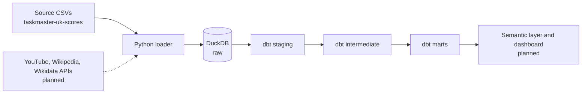

# Taskmaster Analytics
An end-to-end analytics engineering project on the UK TV show *Taskmaster*: a Python loader, a DuckDB warehouse, and a tested, documented dbt star schema covering tasks, episodes, and series.

## Status
- [x] Raw load of the scoring data, with load timestamp and source commit on every table
- [x] dbt project: 4 staging, 5 intermediate, 4 dimension and 3 fact models, 88 data tests
- [x] Documented data-quality findings and modeling decisions
- [ ] Wikipedia pageviews, YouTube snapshots, and Wikidata attributes
- [ ] Orchestration and CI
- [ ] Semantic layer, dashboard, and written findings

## Architecture



Each dbt layer builds into its own schema: `staging`, `intermediate`, `marts`. Marts never read staging directly, and excluded series are removed once, in the intermediate layer.

## Data model

| Table | Grain |
|---|---|
| `fct_task_points` | one row per contestant per task |
| `fct_episode_points` | one row per contestant per episode |
| `fct_series_points` | one row per contestant per series |
| `dim_contestant`, `dim_episode`, `dim_series`, `dim_task` | one row per contestant, episode, series, task |
Definitions, keys, and rules: [data dictionary](docs/data-dictionary.md) and [model design](docs/model-design.md).

## Data quality findings

| Finding | Decision |
|---|---|
| The six New Year Treat series are identical copies of one cast and one set of tasks | [Excluded](docs/data-quality/new-year-treat-series.md) |
| Official episode totals differ from summed task scores in about 24% of contestant-episodes | [Both kept, difference modeled as adjustment points](docs/data-quality/episode-vs-task-scores.md) |

See the [data quality index](docs/data-quality/README.md).

## Quickstart

Full instructions, including Windows setup and troubleshooting, are in [docs/setup.md](docs/setup.md).

```bash
git clone https://github.com/djf0512/taskmaster-analytics.git
cd taskmaster-analytics
python -m venv .venv && source .venv/bin/activate   # Windows: .\.venv\Scripts\Activate.ps1
pip install -r requirements.txt
git clone https://github.com/silverdavi/taskmaster-uk-scores.git data/raw/taskmaster-uk-scores
python ingestion/load_scores.py
cd taskmaster_dbt && dbt build
```

DuckDB and dbt versions are pinned in `requirements.txt`. The DuckDB command-line client must be at least as new as the pinned Python package, or it cannot open the database file.

## Repository layout

```
ingestion/        Python loader (raw layer)
taskmaster_dbt/   dbt project: models, macros, tests
docs/             setup, model design, data dictionary, data-quality findings
data/, warehouse/ local source data and DuckDB file (not committed)
```

## Data source and license

Scoring data comes from [silverdavi/taskmaster-uk-scores](https://github.com/silverdavi/taskmaster-uk-scores), licensed CC BY-SA 4.0 and compiled from the Taskmaster fan wiki. The data is not redistributed in this repository. 

Taskmaster is a trademark of its owners. This is an independent fan project and is not affiliated with or endorsed by the show or its producers.